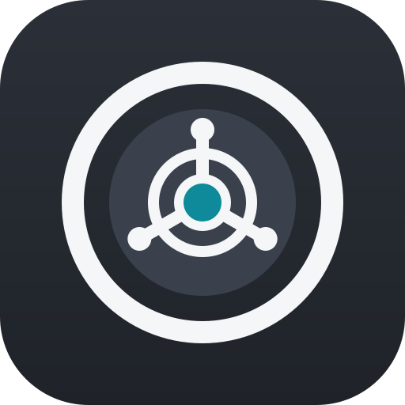

# Personal Vault

**Your personal data, tasks, and tools — all in one place.**

Personal Vault is a personal organization application built with Python and Qt6, designed to bring tasks, calendars, plugins, and eventually AI-powered knowledge retrieval into a single workspace.

The goal is to create a centralized personal environment where you can manage your daily activities, connect external services, and interact with your own information through an intelligent assistant.

> 🚧 **Work in progress:** Personal Vault is actively being developed. The core application is taking shape, while external integrations and AI-powered features are planned for future releases.

## ✨ Features

### 🧩 Plugin System
- Modular architecture designed to extend the application's functionality.
- A foundation for adding new tools and capabilities.
- Prepared for future integrations with external services.

### ✅ Task Management
- **Local tasks:** Create and manage tasks directly within the application.
- **External tasks:** Support planned for tasks coming from connected services.
- A centralized approach to personal task management.

*External task services are not connected yet.*

### 📅 Calendar
- Calendar view displaying tasks on their corresponding dates.
- Visual overview of scheduled activities.
- Easier tracking of upcoming tasks and deadlines.

### 🤖 AI Assistant & RAG — Planned
One of the long-term goals of Personal Vault is to integrate artificial intelligence with **Retrieval-Augmented Generation (RAG)**.

The idea is to let users ask questions about their own information and receive context-aware answers based on their personal data.

Potential capabilities include:
- Asking questions about your tasks, notes, and other stored information.
- Finding relevant information without manually searching through everything.
- Receiving answers grounded in your personal knowledge base.
- Connecting information from different parts of the application.
- Building a more natural way to interact with your personal data.

For example:
- *"What tasks do I still have pending this week?"*
- *"What did I write down about my latest project?"*
- *"What commitments do I have coming up?"*

These are examples of the intended experience, not currently available features.

### 🔌 External Integrations — Planned
Personal Vault is being designed with future external service integrations in mind.

Potential extensions include:
- Synchronizing tasks with external platforms.
- Connecting calendar services.
- Expanding functionality through plugins.
- Using connected information as an additional source for the future AI assistant.

No external services are currently connected.

## 🛠️ Tech Stack

| Technology          | Purpose                               |
|---------------------|---------------------------------------|
| Python              | Application logic and backend         |
| Qt6                 | Desktop user interface                |
| Plugin architecture | Extensibility and future integrations |
| RAG + AI            | Planned personal knowledge retrieval  |

## 📊 Development Status

| Feature                        | Status                |
|--------------------------------|-----------------------|
| Core desktop application       | 🚧 In development     |
| Local task management          | ✅ Available          |
| Calendar view                  | ✅ Available          |
| Plugin system                  | 🚧 In development     |
| External task integrations     | 📋 Planned            |
| External calendar integrations | 📋 Planned            |
| AI assistant with RAG          | 🔮 Future development |

## 🗺️ Roadmap

- [ ] Complete the core application architecture.
- [ ] Refine the plugin system.
- [ ] Improve local task and calendar functionality.
- [ ] Implement external service integrations.
- [ ] Build a personal knowledge retrieval system using RAG.
- [ ] Integrate an AI assistant capable of answering questions about personal information.
- [ ] Explore connections between tasks, calendar events, and other personal data.
- [ ] Improve customization, privacy, and the overall user experience.

## 🚀 Getting Started

Installation and setup instructions will be added once the project structure and dependencies are finalized.

This section will include the required Python version, dependency installation, configuration, and instructions for launching the Qt6 application.

## 🔒 Privacy & Personal Data

Personal Vault aims to provide a centralized environment for managing personal information.

As AI and external integrations are introduced, privacy and control over personal data will be important considerations in the application's design.

Specific data handling policies and AI integration details will be documented as these features are developed.

## 🤝 Contributing

Personal Vault is currently under active development.

Suggestions, feature requests, and bug reports are welcome. Feel free to open an issue to discuss ideas or report problems.

## 📄 License

**License: Not decided yet.**

A license will be selected before the project establishes its distribution terms.

---

**Personal Vault — Your tasks, your tools, your space.**